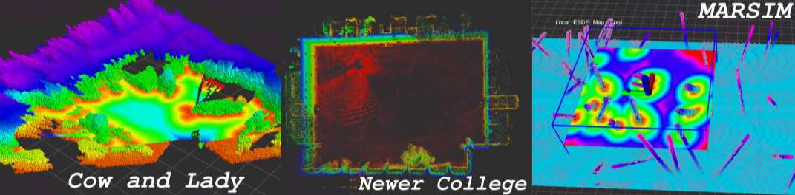

# Overview

## Description
VDBblox leverages the OpenVDB data structure to incrementally build Euclidean Signed Distance Fields (ESDFs) from Truncated Signed Distance Fields (TSDFs) mapping. The framework addresses the challenges of balancing accuracy and efficiency while minimizing computational resources and memory footprint. The proposed method demonstrates superior performance in terms of accuracy and efficiency through benchmark comparisons on public RGB-D and LiDAR datasets. Additionally, VDBblox is successfully integrated into a quadrotor system, validated through real-world experiments for online path-planning.

# Prerequisites

## Dependencies

Target system: Ubuntu `20.04` and `ROS1` Noetic with `C++17`
- g++ (11.4.0)
- cmake (3.30.1)
- Python3 (3.8.10)
- OpenCV (4.7.0)
- eigen (3.3.7)
- gflag (2.2.2)
- glog (0.4.0)
- OpenMP (4.5)
- boost (1.80.0)
- TBB (2021.10)
- OpenVDB: (10.x)


## Using OpenVDB

### System Dependencies

```bash
sudo apt-get update && sudo apt-get install -y libblosc-dev libeigen3-dev
```
>you may need to install some of dependencies libraries from source code to manually upgrade

### Building OpenVDB
```bash
# clone source code
git clone https://github.com/AcademySoftwareFoundation/openvdb.git && cd openvdb

# build
cmake -B build -DCMAKE_C_COMPILER=$(which gcc) -DCMAKE_CXX_COMPILER=$(which g++) -DCMAKE_CXX_STANDARD=17 -DCMAKE_BUILD_TYPE=Release .
cmake --build build --config Release --parallel $(nproc --all)

# install
cd build && sudo make install -j
```
More install options can be found from the official website: [https://www.openvdb.org/documentation/doxygen/build.html](https://www.openvdb.org/documentation/doxygen/build.html)

## Local Install

```bash
# clone source code
mkdir -p catkin_ws/src && cd catkin_ws/src
git clone https://github.com/yinloonga/vdbblox.git

# (optional) disable conda 
conda deactivate
cd ../

# build
catkin config -DCMAKE_BUILD_TYPE=Release \
		-DCMAKE_C_COMPILER=$(which gcc) \
		-DCMAKE_CXX_COMPILER=$(which g++) \
		-DCMAKE_CXX_STANDARD=17
 
catkin build -j "$(nproc --all)"
```
# Datasets

VDBblox can work with RGB-D cameras and LiDAR datasets. It is tested using the [Cow and Lady](https://projects.asl.ethz.ch/datasets/doku.php?id=iros2017/), [Mai City](https://www.ipb.uni-bonn.de/data/mai-city-dataset/index.html), [Newer College](https://ori-drs.github.io/newer-college-dataset/), [Kitti](https://www.cvlibs.net/datasets/kitti/eval_odometry.php) datasets and [MARSIM](https://github.com/hku-mars/MARSIM.git). 
You can modify the parameters in files with suffixed of `.yaml` and `.launch` in the `config` folder. To better run it with a live sensor, please enable the `update_local` in yaml file.

Here are two specific examples using RGB-D and LiDAR respectively for you to try quickly.
If you use a PC with limited computational resources, you could slow down the playback of the rosbag by a factor `rosbag play -r x`.
For the convenience of remote development, we need to manually start rviz for visualization and open the configuration file `*.rviz` in the `config/rviz` directory from rviz.

## Quick Examples

### RGB-D
Since the `cow and lady` is static for a while at the beginning, we can skip this period using the parameter `-s 4.4`

```bash
# source 
source ./devel/setup.zsh

# launch ros node
roslaunch vdbblox_ros vdbblox.launch config_file_name:=CowAndLady.yaml

# vdbblox_default.rviz
rviz
 
# play bag
rosbag play -r 0.5 -s 4.4 --clock data.bag
```

### LiDAR
Same as above, except you have to specify a different parameter file
```bash
# source 
source ./devel/setup.zsh

# launch ros node
roslaunch vdbblox_ros vdbblox.launch config_file_name:=NewerCollege.yaml

# vdbblox_default.rviz
rviz

# play bag
rosbag play -r 0.5 -s 0.0 --clock quad_easy_lidar_labelled_tf.bag
```

## Running with MARSIM
### First, launch the MARSIM
```bash
# source
source ./devel/setup.zsh

# launch marsim ros node
roslaunch test_interface single_drone_os128.launch

# vdbblox_fpv.rviz
rviz

# control with drone with keyboard
roslaunch vdbblox_ros marsim_keyctrl.launch
```
After launch the `Rviz`, you can use `W` `A` `S` `D` on to contorl the drone's velocity, then press `spacebar` to stop,  and `Q` or `Ctrl+C` to exit  

### Second, launch the program

```bash
# source
source ./devel/setup.zsh

# launch node
roslaunch vdbblox_ros vdbblox.launch config_file_name:=MARSIM.yaml
```
# Parameters

All parameters annotations can be found at `template` yaml files in the `config/param` folder.

# TODO
- [ ] Use ROS2 callback function to process topic
- [x] Add local map sliding functionality for the ESDF module like in [ROG-Map](https://github.com/hku-mars/ROG-Map.git)

# Acknowledgement

This projcet is built upon serveral outstanding open-source projects. We extend our gratitude to the developers of the repositories listed below for making their code available. 
- [ethz-asl/voxblox](https://github.com/ethz-asl/voxblox): the mapping library based on SDFs and building ESDFs or EDTs directly from TSDFs
- [PRBonn/vdbfusion_ros](https://github.com/PRBonn/vdbfusion_ros) the framework based on OpenVDB with ROS1

- [HKUST-Aerial-Robotics/FIESTA](https://github.com/HKUST-Aerial-Robotics/FIESTA.git): A novel ESDF updating algorithm based on BFS framework
- [VIS4ROB-lab/voxfield](https://github.com/VIS4ROB-lab/voxfield.git): based on voxblox with non-projective signed distance fields
- [Kin-Zhang/vdbfusion_mapping](https://github.com/Kin-Zhang/vdbfusion_mapping): fixed the pose issue [#2](https://github.com/PRBonn/vdbfusion_ros/issues/2)
- [zhudelong/VDB-EDT](https://github.com/zhudelong/VDB-EDT.git): large-scale occupancy grid mapping and Euclidean distance transform
- [hku-mars/ROG-Map](https://github.com/hku-mars/ROG-Map.git): Keyboard control and integration with [MARSIM](https://github.com/hku-mars/MARSIM.git) for testing and evaluating

Thanks again for their great works.

